# BackupHarbor

**English** · [Türkçe](#turkce)

**Prove that your restic backups can really be restored.**

BackupHarbor is a standalone Windows application that takes your existing
[restic](https://restic.net) backups, restores them into a private work area,
checks the restored files, and reports exactly what was and was not proven.
It consists of a desktop application (`BackupHarbor.exe`) and a command-line
tool (`bharbor.exe`) that share one verification engine, one configuration file
and one report history.

> A backup that "succeeded" is not a backup you can restore. BackupHarbor never
> assumes success: only checks that actually ran and passed are reported as passed.

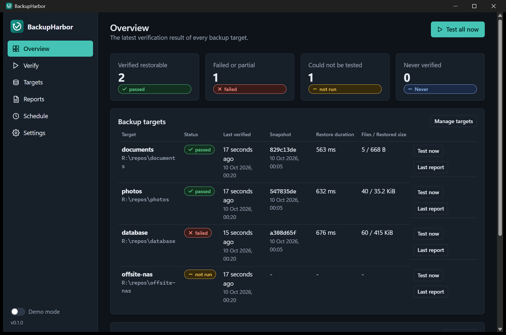

## The problem

Backup tools report that they *wrote* data. They do not tell you that the data
can be read back, decrypted, and used. Silent repository damage, a lost
password, a missing snapshot or a database that was copied mid-write are only
discovered on the worst possible day. Testing restores by hand is tedious, so it
is usually skipped.

## What BackupHarbor does

For every configured repository ("target") it runs real restic commands:

1. **Preflight** - finds restic and checks its version, checks the password source, opens the repository, selects the snapshot, checks the work directory.
2. **Integrity check** - `restic check`, optionally reading all or a sample of the stored data.
3. **Restore** - restores the snapshot into a private work area it created itself, with `restic restore --verify` (restored files are read back and compared with the repository hashes). Duration, file count and size are measured.
4. **Content rules** - checks you define on restored files: exists, not empty, readable text, valid JSON/XML, ZIP opens with CRC check, PDF structure, SQLite `integrity_check`, SHA-256.
5. **Cleanup** - removes the work area, but only after proving it created it.
6. **Report** - JSON, HTML and TXT, with an explicit statement of what the result does and does not prove.

Each stage ends as `passed`, `failed`, `not_run`, `cancelled`, `timed_out`, `partial` (or `skipped` if you disabled it).
A backup that could not be tested is never counted as passed.

## Features

- Desktop app with overview, live verification progress, target editor, report browser, schedule and settings; light, dark and system theme; English and Turkish.
- Command-line tool for scripts and servers: colour with `NO_COLOR` support, `--json` output, stable exit codes.
- Windows Task Scheduler integration managed by the app (only its own task is ever touched).
- Passwords are never stored in the configuration: Windows Credential Manager, an environment variable or a password file.
- Demo mode with clearly marked sample data that never touches a repository.
- No telemetry, no analytics, no auto-update, no hidden downloads.

## Screenshots

All images are captures of the real `BackupHarbor.exe` window (see [Known limitations](#known-limitations) for how they were made).

| | |
|---|---|
| 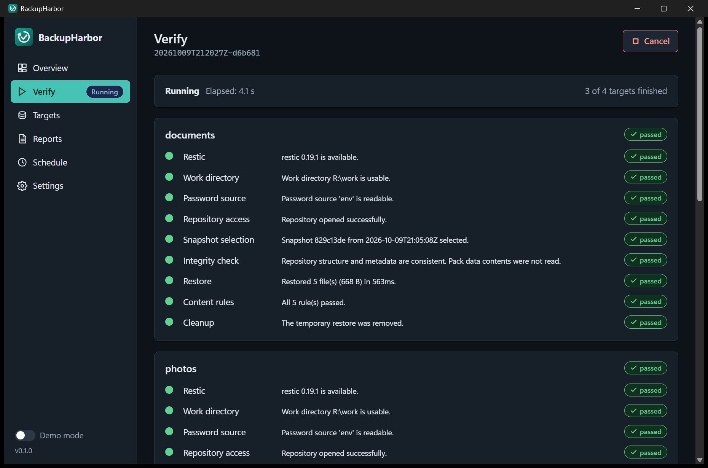 | 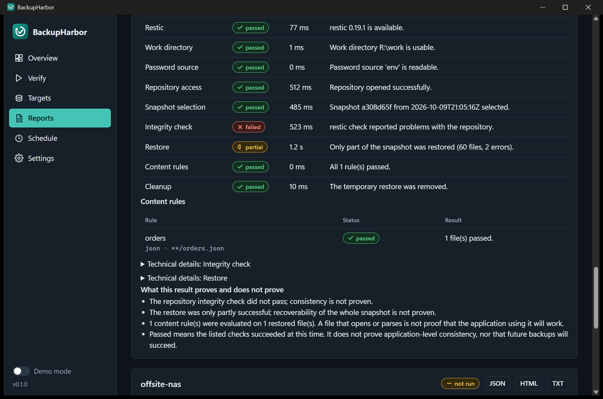 |
| **Live verification.** Every stage of every target shows its own status while the run is in progress. | **A damaged repository.** The integrity check fails, the restore is only partial, and the report states what is and is not proven. |
| 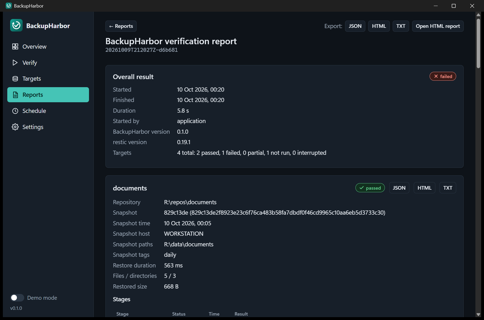 | 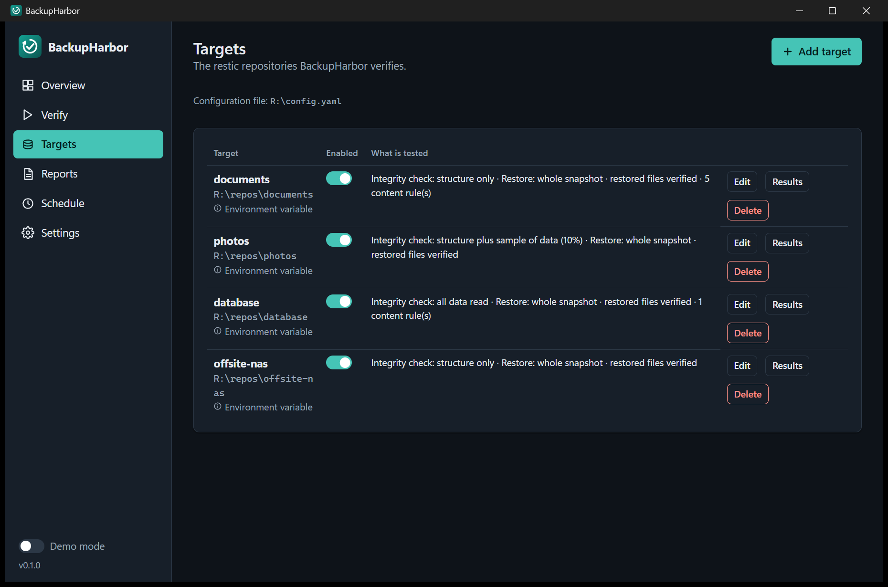 |
| **Report.** Overall result, per-target snapshot details and stage table; export as JSON, HTML or TXT. | **Targets.** Each repository with the checks that are configured for it. |
| 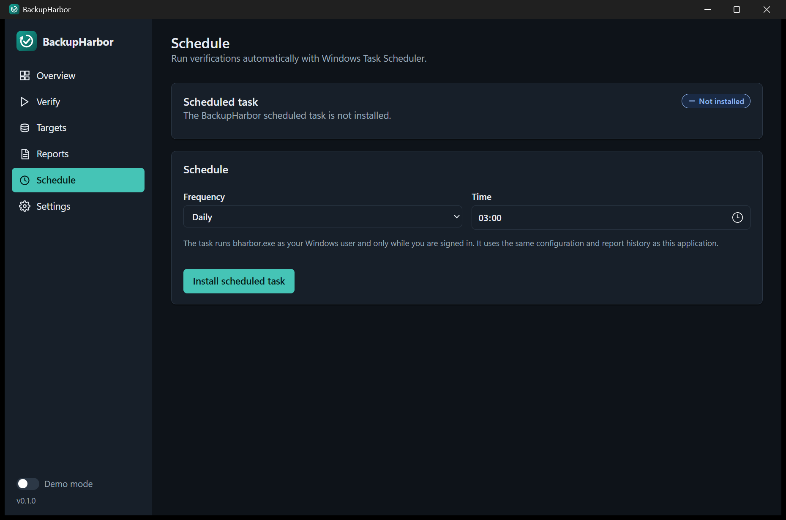 | 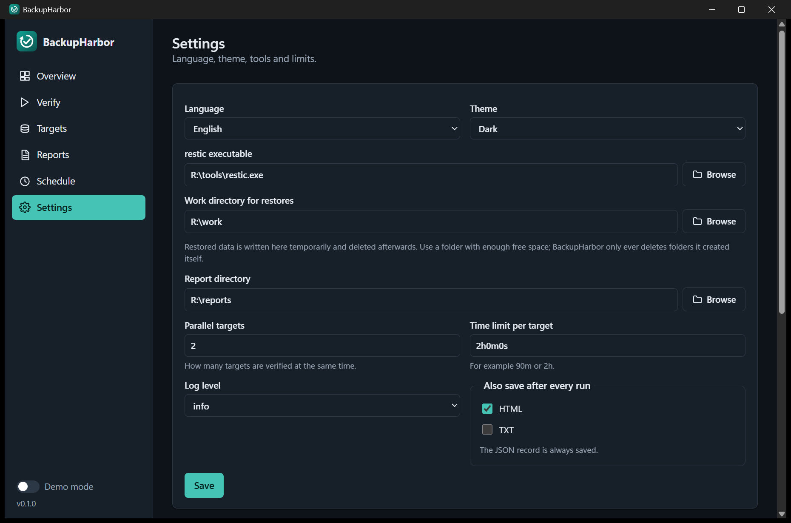 |
| **Schedule.** Installs, shows and removes the one task BackupHarbor owns. | **Settings.** Language, theme, restic, work and report folders, limits. |

The light theme:

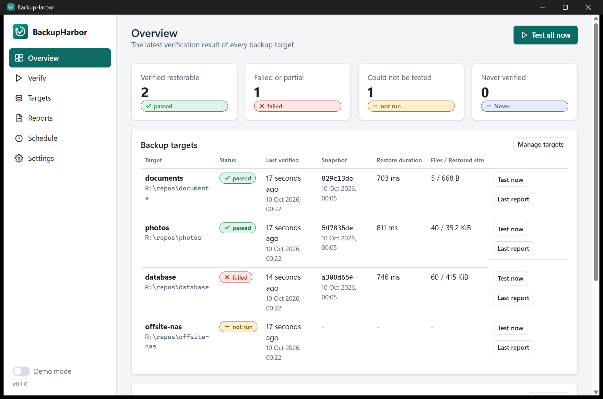

## Requirements

- Windows 10 or 11, x64.
- [restic](https://restic.net) 0.16 or newer. The installer and the portable ZIP already include an unmodified restic (version in `third_party/restic/PIN`), so nothing else needs to be installed; you may choose a different restic in Settings.
- For the desktop app: the Microsoft Edge WebView2 Runtime (preinstalled on current Windows 11 and most Windows 10 systems). The command-line tool does not need it.

## Installation

BackupHarbor is built from source; no release has been published yet.
When releases exist they will contain an installer (`BackupHarbor-<version>-setup.exe`), a portable folder as ZIP and a `SHA256SUMS.txt`. Both ship `restic.exe` next to the application, so they work without installing anything else (the desktop app additionally needs the WebView2 Runtime).

Build it yourself (needs Go 1.26+ and MinGW `windres`; Inno Setup 6 optional for the installer):

```powershell
powershell -ExecutionPolicy Bypass -File scripts\build.ps1
```

The script formats, vets and tests the code, embeds icon and version information,
downloads the pinned official restic release (SHA-256 verified against `third_party/restic/PIN`; `-ResticZip` builds offline) and builds both executables into `dist\BackupHarbor-<version>-win-x64\` (an *onedir*
layout, not a single self-extracting file), creates the ZIP, builds the installer
if Inno Setup is installed, and writes SHA-256 checksums. See [CONTRIBUTING.md](CONTRIBUTING.md).

The installer offers Program Files installation, a Start menu shortcut, an optional
desktop shortcut and an optional PATH entry for `bharbor`. Uninstalling removes only
the PATH entry the installer itself added and keeps your configuration and reports
unless you explicitly agree to delete them.

## Quick start

Command line:

```powershell
bharbor init                      # writes an example configuration (never overwrites)
bharbor secret set my-backup      # stores the repository password in Windows Credential Manager
notepad $env:APPDATA\BackupHarbor\config.yaml
bharbor validate                  # checks everything except the restore
bharbor run                       # verifies all enabled targets
bharbor report --last             # shows the latest report
```

Desktop app: start `BackupHarbor`, follow the setup guide on the overview page
(restic, configuration, first target), press **Test now**. Use **Demo mode** to look
around without any backup.

## Configuration

A YAML file at `%APPDATA%\BackupHarbor\config.yaml` (override with `--config` or
`BACKUPHARBOR_CONFIG`). Relative paths in the file are resolved against the
directory containing the file. Unknown keys are rejected. Minimal example:

```yaml
version: 1
targets:
  - name: documents
    repository: 'D:\Backups\restic'
    password: {source: credential}      # credential | env | file
    rules:
      - {name: accounts, path: '**/accounts.sqlite', type: sqlite}
```

Full reference: [docs/configuration.md](docs/configuration.md).

## Command-line reference

```
bharbor init [--force]
bharbor validate [--target NAME]...
bharbor run [--target NAME]...
bharbor report [--last | --list | --run ID] [--target NAME] [--format json|html|txt] [--output FILE] [--force]
bharbor schedule install|status|remove [--frequency daily|weekly] [--time HH:MM] [--day monday..sunday]
bharbor secret set|delete|status NAME [--stdin]
global: --config FILE  --json  --no-color  --lang en|tr  --verbose  --quiet  --version  --help
```

| Exit code | Meaning |
|---|---|
| 0 | Every target passed. |
| 1 | Verification ran and at least one target failed or was only partly proven. |
| 2 | Configuration, dependency or execution error, **or a target could not be tested**. |
| 3 | Cancelled or timed out. |

Precedence when results are mixed: 3, then 1, then 2, then 0. A cancelled run is never reported as a broken backup.

## Reports

Every run is stored as an immutable JSON record (schema `backupharbor.run/1`, see
[docs/report-schema.md](docs/report-schema.md)) in `%LOCALAPPDATA%\BackupHarbor\reports`.
HTML (single self-contained printable file) and TXT can be exported at any time or
saved automatically. Existing files are never overwritten silently. Both
front ends read the same history.

## Security and privacy

- The backup repository is only read. Restic repository locks are off by default so nothing is written to it.
- Restores go to a work area BackupHarbor creates; cleanup requires an ownership marker, never follows symlinks or junctions, and refuses to run when ownership cannot be proven.
- Passwords never appear on a command line, in logs, reports or error messages; known secrets and credential patterns are masked.
- Subprocesses are started directly (no shell) with separate arguments and are terminated as a process tree on cancellation or timeout.
- No telemetry, no network requests of its own.

Details and the threat model: [docs/security.md](docs/security.md) and [SECURITY.md](SECURITY.md).

## Tests

```powershell
go test ./...
```

Includes tests against a real restic repository when restic is available
(`BH_TEST_RESTIC` or `restic` on PATH); without restic those tests are reported as
skipped, not passed. `BH_TEST_SCHEDULER=1` additionally exercises the real Task
Scheduler. A browser-driven UI smoke test lives in `tools/uidev` (see
[CONTRIBUTING.md](CONTRIBUTING.md)).

## Known limitations

- Windows 10/11 x64 only. restic is the only supported backend.
- The scheduled task runs only while the user is signed in (interactive token), because Windows Credential Manager access requires the user's profile.
- Remote repositories need their credentials (for example `AWS_*`) in the environment of the user that runs BackupHarbor, including the scheduled task.
- restic's `--password-command` is intentionally not supported.
- Restoring a Windows snapshot restores the full original path below the work area, starting with the drive letter as a folder; content rules therefore start with `**/`.
- Restic may report attribute errors (timestamps, ACLs) for parent folders when restoring; they are counted and reported separately and do not turn a restore with intact content into a failure.
- A file that parses or opens does not prove the application using it will work; PDF checks are structural only.
- The binaries are not code-signed, so Windows SmartScreen may warn on first start.
- The screenshots in this README were taken from the real `BackupHarbor.exe` window on Windows 11 while it verified a throw-away set of restic repositories on a neutral drive letter. One of those repositories was damaged on purpose and one does not exist, to show a failed and a not-run result; the data is test data, not a real backup. The date fields on the Reports page follow the language of Windows, not the language of BackupHarbor.

## License

[MIT](LICENSE)

<a id="turkce"></a>

---

# BackupHarbor (Türkçe)

[English](#backupharbor) · **Türkçe**

**restic yedeklerinizin gerçekten geri yüklenebildiğini kanıtlayın.**

BackupHarbor, mevcut [restic](https://restic.net) yedeklerinizi özel bir çalışma
alanına geri yükleyen, geri yüklenen dosyaları denetleyen ve neyin kanıtlanıp neyin
kanıtlanamadığını açıkça raporlayan bağımsız bir Windows uygulamasıdır. Bir masaüstü
uygulamasından (`BackupHarbor.exe`) ve bir komut satırı aracından (`bharbor.exe`)
oluşur; ikisi de aynı doğrulama motorunu, aynı yapılandırma dosyasını ve aynı rapor
geçmişini kullanır.

> "Başarılı" görünen bir yedekleme, geri yükleyebileceğiniz bir yedek demek değildir.
> BackupHarbor başarıyı varsaymaz: yalnızca gerçekten çalışan ve geçen kontroller
> başarılı olarak raporlanır.

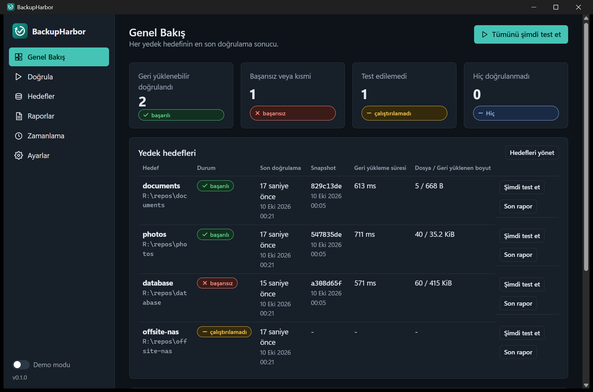

## Sorun

Yedekleme araçları verinin *yazıldığını* bildirir; verinin geri okunabildiğini,
çözülebildiğini ve kullanılabildiğini söylemez. Sessiz depo hasarı, kaybolmuş bir
parola, eksik bir snapshot ya da yazma sırasında kopyalanmış bir veritabanı ancak en
kötü günde fark edilir. Geri yüklemeyi elle test etmek zahmetlidir, bu yüzden genellikle
atlanır.

## BackupHarbor ne yapar

Yapılandırdığınız her depo ("hedef") için gerçek restic komutları çalıştırır:

1. **Ön kontrol** - restic'i bulur ve sürümünü denetler, parola kaynağını kontrol eder, depoyu açar, snapshot'ı seçer, çalışma dizinini denetler.
2. **Bütünlük kontrolü** - `restic check`; isteğe bağlı olarak saklanan verinin tamamı ya da bir örneği okunur.
3. **Geri yükleme** - Snapshot, kendi oluşturduğu özel bir çalışma alanına `restic restore --verify` ile geri yüklenir (dosyalar geri okunup depodaki özetlerle karşılaştırılır). Süre, dosya sayısı ve boyut ölçülür.
4. **İçerik kuralları** - Tanımladığınız denetimler: dosya var mı, boş mu, okunabilir metin, geçerli JSON/XML, ZIP açılıyor mu (CRC dahil), PDF yapısı, SQLite `integrity_check`, SHA-256.
5. **Temizlik** - Çalışma alanı, yalnızca onu kendisinin oluşturduğu kanıtlandıktan sonra silinir.
6. **Rapor** - JSON, HTML ve TXT; sonucun neyi kanıtlayıp neyi kanıtlamadığı açıkça yazılır.

Her aşama `passed` (başarılı), `failed` (başarısız), `not_run` (çalıştırılamadı),
`cancelled` (iptal), `timed_out` (zaman aşımı), `partial` (kısmi) olarak biter;
devre dışı bıraktığınız aşamalar `skipped` olarak görünür. Test edilemeyen bir yedek
asla başarılı sayılmaz.

## Özellikler

- Genel bakış, canlı doğrulama ilerlemesi, hedef düzenleyici, rapor tarayıcısı, zamanlama ve ayarlar içeren masaüstü uygulaması; açık, koyu ve sistem teması; Türkçe ve İngilizce.
- Betikler ve sunucular için komut satırı aracı: `NO_COLOR` destekli renk, `--json` çıktısı, kararlı çıkış kodları.
- Uygulamanın yönettiği Windows Görev Zamanlayıcı entegrasyonu (yalnızca kendi görevine dokunulur).
- Parolalar yapılandırmada asla saklanmaz: Windows Kimlik Bilgisi Yöneticisi, ortam değişkeni veya parola dosyası.
- Gerçek depolara hiç dokunmayan, açıkça işaretli örnek verili demo modu.
- Telemetri yok, analitik yok, otomatik güncelleme yok, gizli indirme yok.

## Ekran görüntüleri

Tüm görüntüler gerçek `BackupHarbor.exe` penceresinden alınmıştır (nasıl alındıkları için [Bilinen sınırlamalar](#bilinen-sınırlamalar) bölümüne bakın). Arayüz Türkçe olarak çalışırken yakalanmıştır.

| | |
|---|---|
| 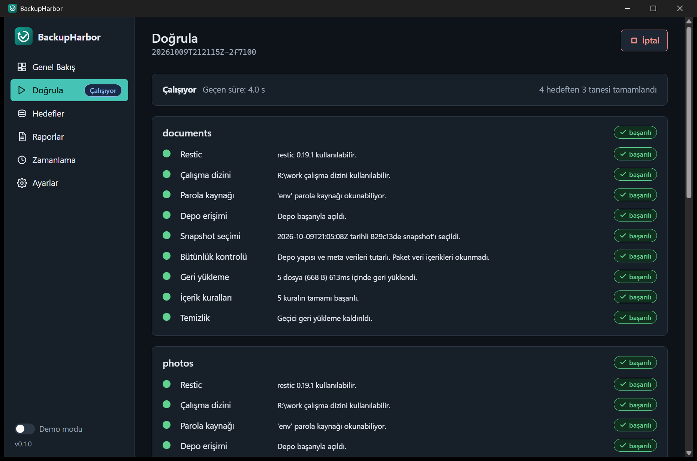 | 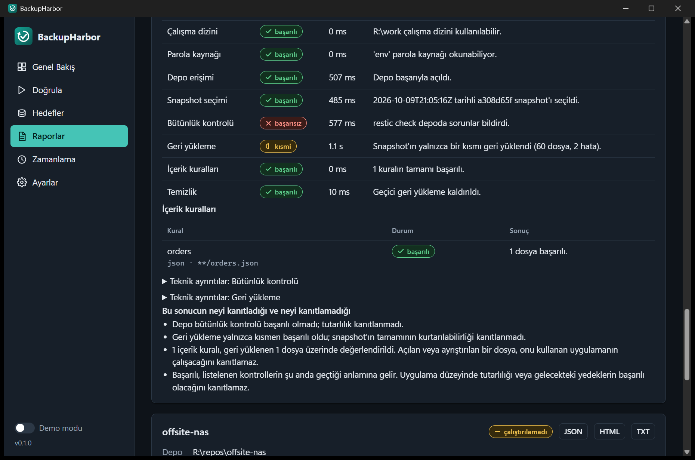 |
| **Canlı doğrulama.** Çalıştırma sürerken her hedefin her aşaması kendi durumunu gösterir. | **Hasarlı bir depo.** Bütünlük kontrolü başarısız olur, geri yükleme yalnızca kısmen yapılır; rapor neyin kanıtlanıp neyin kanıtlanmadığını yazar. |
| 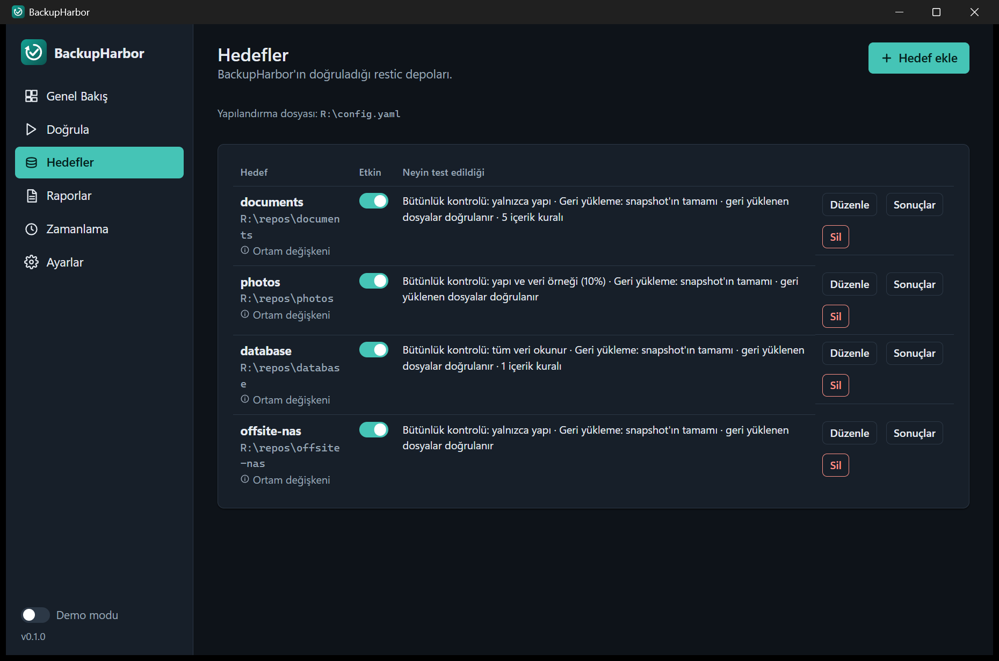 | 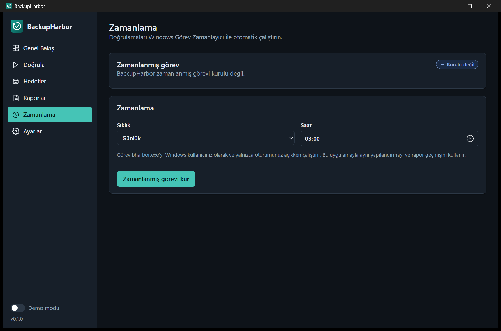 |
| **Hedefler.** Her depo ve onun için yapılandırılmış denetimler. | **Zamanlama.** BackupHarbor'ın sahibi olduğu tek görevi kurar, gösterir ve kaldırır. |
| 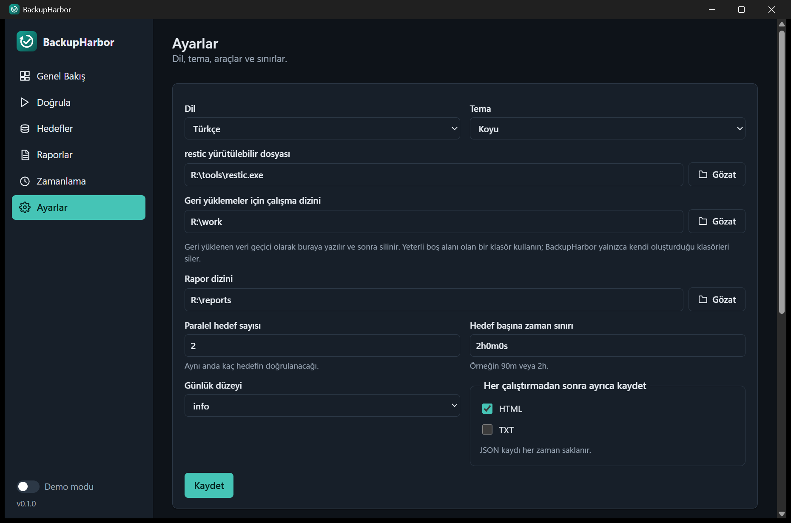 | |
| **Ayarlar.** Dil, tema, restic, çalışma ve rapor klasörleri, sınırlar. | |

## Gereksinimler

- Windows 10 veya 11, x64.
- [restic](https://restic.net) 0.16 veya daha yeni. Kurulum programı ve taşınabilir ZIP, değiştirilmemiş bir restic'i (sürüm `third_party/restic/PIN` içinde) zaten içerir; ayrıca bir şey kurmanız gerekmez, isterseniz Ayarlar'dan başka bir restic seçebilirsiniz.
- Masaüstü uygulaması için Microsoft Edge WebView2 Çalışma Zamanı (güncel Windows 11'de ve çoğu Windows 10'da hazır gelir). Komut satırı aracı buna ihtiyaç duymaz.

## Kurulum

BackupHarbor şimdilik kaynaktan derlenir; henüz yayımlanmış bir sürüm yoktur.
Sürümler yayımlandığında kurulum programı (`BackupHarbor-<sürüm>-setup.exe`), taşınabilir
klasör (ZIP) ve `SHA256SUMS.txt` içerecektir. İkisi de `restic.exe`'yi uygulamanın yanında getirir; başka bir şey kurmadan çalışırlar (masaüstü uygulaması ayrıca WebView2 Çalışma Zamanı ister).

Kendiniz derleyin (Go 1.26+ ve MinGW `windres` gerekir; kurulum programı için Inno Setup 6 isteğe bağlı):

```powershell
powershell -ExecutionPolicy Bypass -File scripts\build.ps1
```

Betik kodu biçimlendirme, `go vet` ve testlerden geçirir, simge ve sürüm bilgisini
gömer, sabitlenmiş resmî restic sürümünü indirir (SHA-256 değeri `third_party/restic/PIN` ile doğrulanır; çevrimdışı derleme için `-ResticZip`), iki çalıştırılabilir dosyayı `dist\BackupHarbor-<sürüm>-win-x64\` klasörüne
(*onedir* düzeni; tek dosyalık kendi kendini açan paket değil) derler, ZIP oluşturur,
Inno Setup kuruluysa kurulum programını üretir ve SHA-256 sağlama toplamlarını yazar.
Ayrıntılar için [CONTRIBUTING.md](CONTRIBUTING.md).

Kurulum programı Program Files'a kurulum, Başlat menüsü kısayolu, isteğe bağlı masaüstü
kısayolu ve `bharbor` için isteğe bağlı PATH girdisi sunar. Kaldırma sırasında yalnızca
kurulum programının kendi eklediği PATH girdisi silinir; siz açıkça onaylamadıkça
yapılandırmanız ve raporlarınız korunur.

## Hızlı başlangıç

Komut satırı:

```powershell
bharbor init                      # örnek yapılandırma yazar (asla üzerine yazmaz)
bharbor secret set yedegim        # depo parolasını Windows Kimlik Bilgisi Yöneticisi'ne kaydeder
notepad $env:APPDATA\BackupHarbor\config.yaml
bharbor validate                  # geri yükleme dışında her şeyi denetler
bharbor run                       # etkin tüm hedefleri doğrular
bharbor report --last             # son raporu gösterir
```

Masaüstü uygulaması: `BackupHarbor`'u başlatın, genel bakış sayfasındaki kurulum
rehberini izleyin (restic, yapılandırma, ilk hedef) ve **Şimdi test et**'e basın.
Hiçbir yedeğiniz olmadan göz atmak için **Demo modu**'nu kullanın.

## Yapılandırma

`%APPDATA%\BackupHarbor\config.yaml` konumunda bir YAML dosyası (`--config` veya
`BACKUPHARBOR_CONFIG` ile değiştirilebilir). Dosyadaki göreli yollar, dosyanın
bulunduğu dizine göre çözülür. Bilinmeyen anahtarlar reddedilir. En küçük örnek:

```yaml
version: 1
targets:
  - name: belgeler
    repository: 'D:\Yedekler\restic'
    password: {source: credential}      # credential | env | file
    rules:
      - {name: muhasebe, path: '**/muhasebe.sqlite', type: sqlite}
```

Tam başvuru: [docs/configuration.md](docs/configuration.md) (İngilizce).

## Komut satırı başvurusu

```
bharbor init [--force]
bharbor validate [--target AD]...
bharbor run [--target AD]...
bharbor report [--last | --list | --run KİMLİK] [--target AD] [--format json|html|txt] [--output DOSYA] [--force]
bharbor schedule install|status|remove [--frequency daily|weekly] [--time SS:DD] [--day monday..sunday]
bharbor secret set|delete|status AD [--stdin]
genel: --config DOSYA  --json  --no-color  --lang en|tr  --verbose  --quiet  --version  --help
```

| Çıkış kodu | Anlamı |
|---|---|
| 0 | Tüm hedefler başarılı. |
| 1 | Doğrulama çalıştı ve en az bir hedef başarısız oldu ya da yalnızca kısmen kanıtlandı. |
| 2 | Yapılandırma, bağımlılık veya çalıştırma hatası **ya da bir hedef test edilemedi**. |
| 3 | İptal edildi veya zaman aşımına uğradı. |

Sonuçlar karışık olduğunda öncelik: 3, sonra 1, sonra 2, sonra 0. İptal edilen bir
çalıştırma asla bozuk yedek olarak raporlanmaz.

## Raporlar

Her çalıştırma, `%LOCALAPPDATA%\BackupHarbor\reports` altında değiştirilemez bir JSON
kaydı olarak saklanır (şema `backupharbor.run/1`, bkz. [docs/report-schema.md](docs/report-schema.md)).
HTML (tek dosya, kendi içinde eksiksiz, yazdırılabilir) ve TXT istenildiğinde dışa
aktarılır veya her çalıştırmadan sonra otomatik kaydedilir. Var olan dosyaların üzerine
sessizce yazılmaz. Her iki arayüz de aynı geçmişi okur.

## Güvenlik ve gizlilik

- Yedek depo yalnızca okunur. restic depo kilitleri varsayılan olarak kapalıdır; depoya hiçbir şey yazılmaz.
- Geri yüklemeler BackupHarbor'ın oluşturduğu çalışma alanına gider; temizlik için sahiplik işareti gerekir, sembolik bağları ve junction'ları asla izlemez, sahiplik kanıtlanamıyorsa çalışmayı reddeder.
- Parolalar komut satırında, günlüklerde, raporlarda veya hata mesajlarında görünmez; bilinen sırlar ve kimlik bilgisi desenleri maskelenir.
- Alt süreçler kabuk kullanılmadan, ayrı argümanlarla başlatılır; iptal veya zaman aşımında süreç ağacıyla birlikte sonlandırılır.
- Telemetri yok, kendi başına ağ isteği yok.

Ayrıntılar ve tehdit modeli: [docs/security.md](docs/security.md) ve [SECURITY.md](SECURITY.md).

## Testler

```powershell
go test ./...
```

restic mevcutsa (`BH_TEST_RESTIC` veya PATH'te `restic`) gerçek bir restic deposuna karşı
testler de çalışır; restic yoksa bu testler başarılı değil, atlanmış olarak raporlanır.
`BH_TEST_SCHEDULER=1` gerçek Görev Zamanlayıcı'yı da dener. Tarayıcıyla sürülen bir arayüz
duman testi `tools/uidev` altındadır (bkz. [CONTRIBUTING.md](CONTRIBUTING.md)).

## Bilinen sınırlamalar

- Yalnızca Windows 10/11 x64. Desteklenen tek yedekleme arka ucu restic'tir.
- Zamanlanmış görev yalnızca kullanıcı oturum açıkken çalışır (etkileşimli belirteç); çünkü Windows Kimlik Bilgisi Yöneticisi erişimi kullanıcı profili gerektirir.
- Uzak depolar, kimlik bilgilerini (örneğin `AWS_*`) BackupHarbor'ı çalıştıran kullanıcının ortamında, zamanlanmış görev dahil, bulundurmalıdır.
- restic'in `--password-command` özelliği bilerek desteklenmez.
- Bir Windows snapshot'ı geri yüklendiğinde özgün yolun tamamı çalışma alanının altında, sürücü harfi bir klasör olarak başlayacak biçimde oluşur; bu yüzden içerik kuralları `**/` ile başlar.
- restic geri yüklemede üst klasörler için öznitelik hataları (zaman damgası, ACL) bildirebilir; bunlar ayrı sayılır ve raporlanır, içeriği sağlam bir geri yüklemeyi başarısız yapmaz.
- Açılan veya ayrıştırılan bir dosya, onu kullanan uygulamanın çalışacağını kanıtlamaz; PDF denetimleri yalnızca yapıseldir.
- İkili dosyalar kod imzalı değildir; Windows SmartScreen ilk açılışta uyarabilir.
- Bu README'deki ekran görüntüleri, Windows 11'de gerçek `BackupHarbor.exe` penceresinden, tarafsız bir sürücü harfindeki geçici restic depolarını doğrularken alınmıştır. Başarısız ve çalıştırılamadı sonuçlarını göstermek için depolardan biri bilerek bozulmuş, biri ise hiç oluşturulmamıştır; veriler gerçek bir yedek değil, test verisidir. Raporlar sayfasındaki tarih alanları BackupHarbor'ın değil, Windows'un diline uyar.

## Lisans

[MIT](LICENSE)
